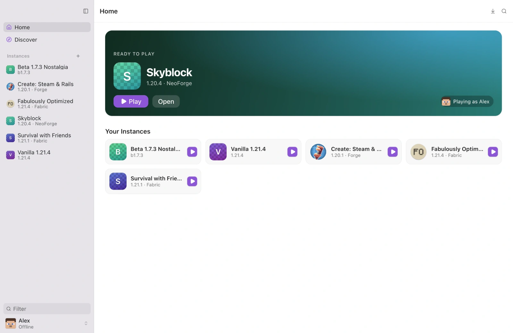
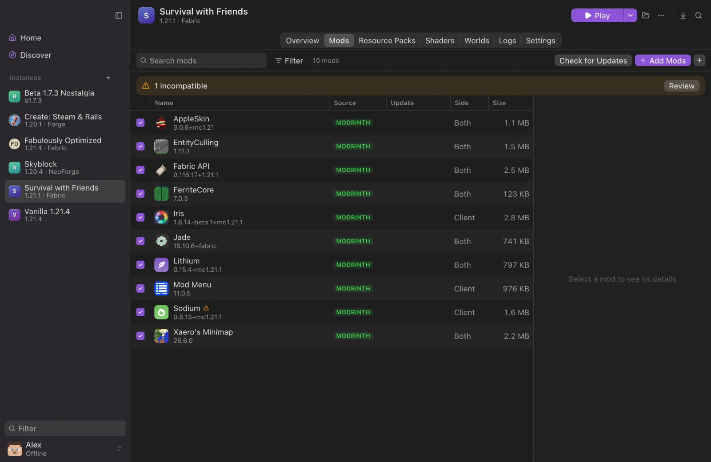
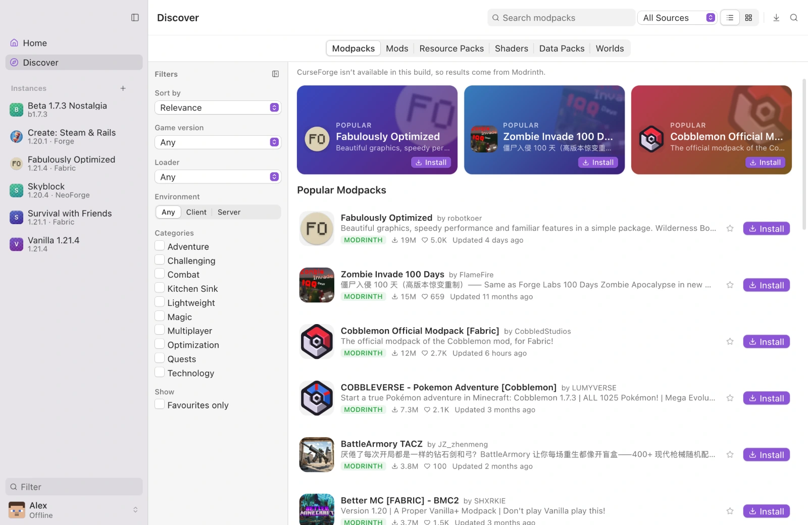

# Amethyst

A fast Minecraft: Java Edition launcher for macOS on Apple Silicon that feels like a native Mac
app. Every Minecraft version, from the oldest classic builds to the latest release, runs
natively on arm64, with no Rosetta.

<p align="center">
  
</p>

Amethyst is free software under the GPL-3.0. It is an independent, clean-room implementation and
is under active development. Builds are released as rolling nightlies.

## Features

- **Instances.** Create, edit, duplicate and delete instances (deleted instances go to the
  Trash), or import an existing game folder. Each instance has its own mods, resource packs,
  shader packs and worlds. Identical files are stored once and placed into each instance with
  APFS clones or hard links.
- **Every loader.** Install vanilla, Forge, NeoForge, Fabric or Quilt.
- **Launching.** Play an instance, follow the live game log, and read crashes in the crash view.
- **Content management.** Manage mods, resource packs, shader packs and worlds. Every content tab
  can add files from another instance.
- **Modrinth and CurseForge.** Browse, install and update content from both sites in Discover.
- **Modpacks.** Import and export Modrinth `.mrpack` files and CurseForge zips. Modpack updates
  can be rolled back. For CurseForge files whose authors block third-party downloads, Amethyst
  links to each file's page and watches `~/Downloads` for the file.
- **Java.** Amethyst finds the Java installations already on your Mac. When a version needs a
  Java you don't have, it downloads it automatically.
- **Accounts.** Use Microsoft and offline accounts. A 3D skin viewer lets you change skins and
  capes.
- **World backups.** Back up a world manually. Amethyst also backs up worlds automatically before
  a version or modpack change, and you can restore any backup as a copy or in place.
- **Themes.** Light and dark modes follow the system. You can also set an accent colour, a
  background image or video, and blur.
- **In-app updates.** Updates download in the background, then show "Restart to Update".

## Screenshots

<p align="center">
  <br>
  <br>
  
</p>

## Native on Apple Silicon

Amethyst picks native libraries for each launch based on the architecture of the Java it uses,
not the launcher's own. As a result, every Minecraft version runs as arm64 code.

- **Minecraft 1.19 and later** already ship LWJGL 3 `natives-macos-arm64`, so Amethyst uses them
  as they are.
- **Minecraft 1.13 to 1.18** use older LWJGL 3 releases, which have no arm64 natives. Amethyst
  replaces them with the official LWJGL 3.3.x macOS arm64 natives from Maven Central. One
  exception is GLFW. In LWJGL 3.3.1, GLFW reports `glfwSetWindowIcon` as an error on macOS, and
  these Minecraft versions treat that error as fatal. Amethyst therefore builds its own
  `libglfw.dylib` in CI from the same upstream GLFW source, with that one call made a silent
  no-op ([`natives/lwjgl3-glfw`](natives/lwjgl3-glfw)).
- **Minecraft 1.12.2 and older** use LWJGL 2, which Mojang only ships for Intel. Amethyst builds
  arm64 LWJGL 2 natives from public source in CI ([`natives/lwjgl2`](natives/lwjgl2)). Those
  builds include OpenAL Soft (`openal.dylib`, the game's audio library) and JInput.
- Amethyst publishes these builds on its own GitHub releases and pins their sha256 values in the
  app. It uses no third-party prebuilt native binaries.
- **Java** comes from Mojang's `mac-os-arm64` runtimes where Mojang provides one. Otherwise, for
  example for Java 8 and Java 16, it comes from **Azul Zulu** through Azul's metadata API,
  verified with sha256.

## Privacy

Telemetry is opt-in. First run offers two toggles, **Share usage data** and **Send crash
reports**, and both are off by default. If you leave them off, nothing is sent and nothing is
kept to send later. You can change either one in Settings → Privacy. Amethyst doesn't record
your IP address, doesn't use session replay, and removes paths and usernames from reports.
[docs/PRIVACY.md](docs/PRIVACY.md) lists every event and property.

## Download

**[Download Amethyst-arm64.dmg](https://github.com/wynn-dev/amethyst/releases/download/nightly/Amethyst-arm64.dmg)**

- Requires **macOS 13 Ventura or later** on **Apple Silicon** (M1 or newer). Intel Macs are not
  supported.
- This is the rolling nightly build. Every push to `main` replaces it. The
  [nightly release](https://github.com/wynn-dev/amethyst/releases/tag/nightly) shows what's in
  it.
- Builds are signed with a Developer ID and notarized by Apple.
- Amethyst updates itself. Each update downloads in the background, then **Restart to Update**
  appears.

New to Amethyst? Read the [user guide](docs/USER-GUIDE.md).

## Building from source

You need Node.js 24 or later and pnpm, at the version set in `packageManager` in `package.json`
(currently pnpm 12). Use pnpm only.

```sh
pnpm install
pnpm dev      # run the app with hot reload
pnpm test     # unit tests (offline)
pnpm build    # production build
pnpm dist     # unsigned .dmg and .zip in apps/desktop/release/
```

Credentials are optional build-time settings. Copy
[`apps/desktop/.env.example`](apps/desktop/.env.example) to `apps/desktop/.env.local` and fill
in whichever of these you have:

- `AMETHYST_MSA_CLIENT_ID`: an Azure app ID that Mojang has approved for the Minecraft API.
- `AMETHYST_CURSEFORGE_API_KEY`
- `AMETHYST_POSTHOG_KEY`

Each missing credential switches off its feature gracefully. Without the Azure app ID, Microsoft
sign-in shows as unavailable. Without the CurseForge key, CurseForge is hidden. Without the
PostHog key, telemetry does nothing.

## Architecture

Amethyst is an Electron app with three tiers of processes, so background work never blocks the
UI:

- **Renderer.** The UI, built with React 19, Tailwind v4 and Radix. It talks to the runtime
  over a `MessagePort`.
- **Main process.** The Electron main process, kept small. It handles windows, menus, dialogs,
  the updater, and supervising the runtime.
- **Runtime.** A `utilityProcess` that owns all domain logic, such as instances, installs,
  accounts and launching. It hands CPU-heavy work like hashing, unzipping and SQLite to
  `worker_threads`.

The domain code lives in pure-Node packages under `packages/`:

| Package | Purpose |
|---|---|
| `task` | Task trees and progress |
| `net` | HTTP and the downloader |
| `nbt` | NBT reading and writing |
| `zip` | Zip reading and writing |
| `content` | Parsers for content files |
| `marketplace` | Modrinth and CurseForge API clients |
| `auth` | Microsoft and offline accounts |
| `game` | Version models and launch |
| `installer` | Installers for vanilla and the mod loaders |
| `java` | Java discovery and downloads |
| `modpack` | Modpack import and export |
| `telemetry` | Opt-in telemetry |

The app itself is in `apps/desktop`.

For more detail, read [docs/ARCHITECTURE.md](docs/ARCHITECTURE.md),
[docs/STORAGE.md](docs/STORAGE.md), the behavioural specs in [docs/specs/](docs/specs/) (with
[DECISIONS.md](docs/specs/DECISIONS.md) as the authority), and
[CONTRIBUTING.md](CONTRIBUTING.md).

## Clean-room implementation

Amethyst is written from scratch. Its code is not read from, copied from or ported from other
Minecraft launchers. It is built from its own specs, public documentation, and observation of
real data such as version JSONs, jars and API responses.
[CONTRIBUTING.md](CONTRIBUTING.md) and [docs/ARCHITECTURE.md](docs/ARCHITECTURE.md) explain the
policy contributors must follow.

## Acknowledgements

Amethyst builds on the public formats, APIs and projects of:

- **Mojang**: piston-meta and the launcher metadata (version manifests, Java runtime manifests,
  libraries and assets), and the Minecraft services that sign-in and profiles use.
- **Modrinth**: the Modrinth API and the `.mrpack` format.
- **CurseForge**: the CurseForge Core API and its modpack format.
- **Fabric** and **Quilt**: their meta servers and loaders.
- **Forge** and **NeoForge**: their Maven repositories and installers.
- **LWJGL**: the arm64 natives from Maven Central, and the LWJGL 2 source used to build arm64
  natives.
- **GLFW**: the source for the patched GLFW used with Minecraft 1.13 to 1.18.
- **OpenAL Soft**: the audio library built for the LWJGL 2 natives.
- **Azul Zulu**: arm64 Java builds where Mojang ships none.

## Licence

Amethyst is licensed under the [GNU General Public License v3.0 only](LICENSE)
(GPL-3.0-only).

Amethyst is not affiliated with Mojang or Microsoft. Minecraft is a trademark of
Mojang/Microsoft.
